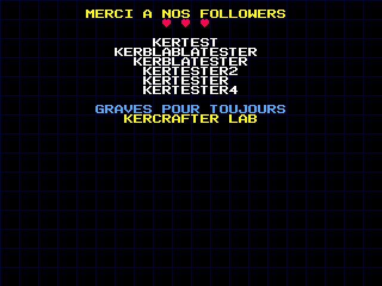

   

# KerCrafter Lab — mur des followers (Tiny Tapeout)

Chaque follower de la chaîne Twitch **KerCrafter Lab** est gravé dans cette puce : ses pseudos défilent
sur un écran de remerciement VGA, comme un générique de fin.



## Comment un pseudo arrive dans la puce

1. Pendant le live, l'alerte follow de l'overlay OBS appelle l'API GitHub (`workflow_dispatch`).
2. Le workflow **Nouveau follower** :
   - valide le pseudo (lettres, chiffres, `_`, 25 caractères max) et ignore les doublons ;
   - l'ajoute à [`followers.txt`](followers.txt) ;
   - régénère `src/credits_rom.v`, `src/font_rom.v` et l'aperçu `docs/apercu.png` ;
   - lance les tests cocotb ;
   - crée **une branche par follower** (`follower/<pseudo>`), ouvre la Pull Request et la fusionne aussitôt.
3. Un message dans le tchat Twitch mentionne le follower, le remercie et lui donne le lien de sa Pull Request.
4. La branche et la PR restent en ligne : chaque follower peut garder son lien et le partager,
   par exemple `https://github.com/<dépôt>/tree/follower/PixelSoudeur`.

`followers.txt` est la seule source : les fichiers `src/credits_rom.v`, `src/font_rom.v` et
sont générés par `python scripts/followers.py gen`.

## Matériel

- Sortie : Pmod TinyVGA (640×480 @ 60 Hz, horloge 25,175 MHz)
- `ui_in[0]` pause, `ui_in[1]` défilement rapide

## Tester en local

```sh
pip install -r test/requirements.txt pillow
python scripts/followers.py add MonPseudo   # ajoute un pseudo et régénère
cd test && make                             # tests (Icarus Verilog)
```

Le test compare pixel par pixel les 64 premières lignes affichées par la puce avec le modèle Python
qui produit `docs/apercu.png`.

## Place sur le silicium

Chaque pseudo ajoute environ 17 portes logiques (estimation Yosys, à confirmer par le flot GDS
de Tiny Tapeout) : la base fait ~760 portes, ~1 300 avec 30 pseudos, ~2 300 avec 100.
Si le flot GDS signale que la tuile est pleine, augmenter `tiles` dans `info.yaml`.

## Message dans le tchat Twitch

À la fin du workflow, un message est envoyé dans le tchat :
« @Pseudo un GRAND merci pour le follow ❤ Ton pseudo est maintenant gravé pour toujours dans notre puce Tiny Tapeout : <lien de sa Pull Request> »

Secrets à créer (Settings > Secrets and variables > Actions) :

| Secret | Contenu |
|---|---|
| `TWITCH_CLIENT_ID` / `TWITCH_CLIENT_SECRET` | une application créée sur dev.twitch.tv (type « Confidentiel ») |
| `TWITCH_REFRESH_TOKEN` | jeton de rafraîchissement du compte qui écrit, avec le scope `user:write:chat` (par ex. via la Twitch CLI : `twitch token -u -s user:write:chat`) |
| `TWITCH_BROADCASTER_ID` | l'identifiant numérique de la chaîne |
| `TWITCH_SENDER_ID` | l'identifiant numérique du compte qui écrit (la chaîne elle-même ou un bot) |

Sans ces secrets, la gravure fonctionne quand même : seul le message n'est pas envoyé.

## Tiny Tapeout

Projet pour le shuttle **TTSKY26d** (SkyWater 130 nm). Le flot GDS, la documentation et les tests sont
ceux du [modèle officiel](https://github.com/TinyTapeout/ttsky-verilog-template). Pour en savoir plus :
https://tinytapeout.com
